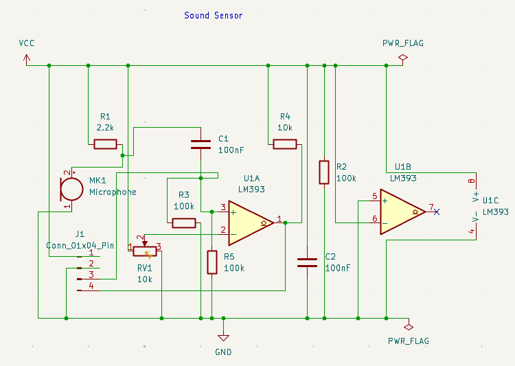
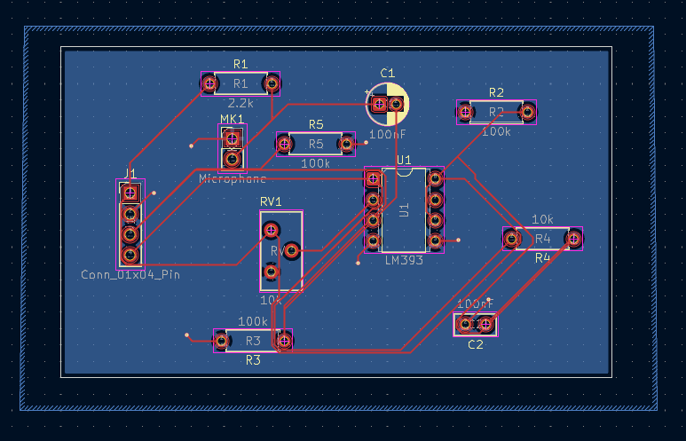
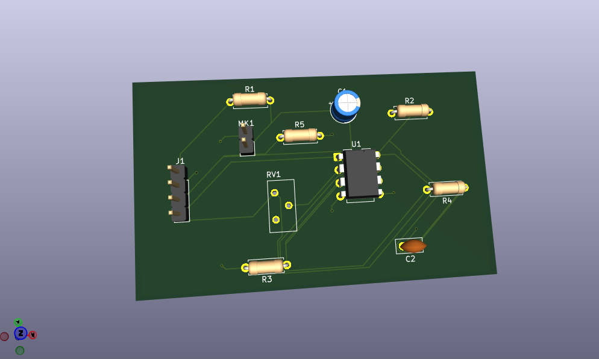

# Sound Sensor PCB — LM393 Comparator Breakout Board

**Status:** Schematic and PCB layout designed in KiCad; gerbers exported, pending fabrication. KiCad source files, ERC/DRC results, the manufacturing package, assembly, and bench testing are not yet uploaded here. Figures below are calculated from nominal component values or from a model run on a synthetic signal, not measured.

[](media/schematic.png)

[](media/layout.png)

[](media/3d.png)

## What This Is

A sound-detection breakout board built around an LM393 dual comparator, designed as a custom version of the common KY-038 module. An electret microphone feeds one comparator input; a 10 kΩ potentiometer sets the threshold on the other. The board brings out a 4-pin header with power, the analog microphone signal (AO), and a digital "sound detected" output (DO) for use with an Arduino or similar microcontroller.

## How the Circuit Works

| Block | Parts | Role |
| ----- | ----- | ---- |
| Microphone | MK1 (electret), R1 (2.2 kΩ) | R1 biases the electret's internal JFET from VCC. Sound varies the JFET current, producing a small AC voltage on MK1 pin 2. |
| Coupling / input bias | C1 (100 nF), R3 (100 kΩ), R5 (100 kΩ) | C1 strips the DC bias and passes the audio to U1A + (pin 3). R3 and R5 both tie pin 3 to GND, so the + input sits at 0 V DC through ≈ 50 kΩ. Together with C1 this forms a high-pass filter at ≈ 30 Hz. |
| Sensitivity | RV1 (10 kΩ) | Ends across VCC and GND; the wiper sets the threshold on U1A − (pin 2). |
| Comparator | U1A (LM393, pins 1–3) | DO goes high (via R4) when the audio on pin 3 exceeds the threshold on pin 2; otherwise the open-collector output pulls DO low. |
| Output pull-up | R4 (10 kΩ) | Pin 1 to VCC. Needed because LM393 outputs are open-collector. |
| Unused comparator | U1B (pins 5–7) | Pin 5 (+) to GND, pin 6 (−) to VCC, so the output is held in a defined (low) state. Pin 7 is not connected. |
| Supply | C2 (100 nF), R2 (100 kΩ), U1 pins 8/4 | C2 decouples VCC to GND. R2 is connected directly across VCC and GND (see design observations). |
| Connector | J1 (1×4 pin header) | Pin 1 = VCC, pin 2 = GND, pin 3 = AO (U1A + / C1 node), pin 4 = DO (U1A output). |

## Results

All values assume a 5 V supply, which is not yet confirmed as the design voltage.

| Parameter | Value | Evidence or qualification |
| --------- | ----- | ------------------------- |
| + input DC bias | 0 V through ≈ 50 kΩ | Calculated: R3 ∥ R5 |
| Audio high-pass corner | ≈ 30 Hz | Calculated: 1 / (2π × (R1 + R3 ∥ R5) × C1) |
| Threshold range | 0 V to VCC | RV1 across the full supply |
| Threshold change per 1 % of RV1 travel | ≈ 50 mV | Calculated: VCC / 100 |
| Supply current, passive parts | ≈ 0.55 mA, plus 0.5 mA through R4 when DO is low | Calculated: RV1 0.5 mA + R2 50 µA. Excludes LM393 and microphone current. |
| Detection of a 30 mV, 1 kHz burst | Detected at a 20–30 mV threshold. One false trigger at 20 mV, none at 25 mV. | Model run on `workdir/synthetic_clap.dat` (synthetic, not recorded). |
| Microphone sensitivity / output level | pending | Depends on capsule part number; to be measured |
| ERC / DRC / parity | pending | Reports not yet uploaded |
| Manufacturing package | pending | Gerbers exported but not yet uploaded |

The synthetic signal contains a 50 mV, 10 Hz drift. The ≈ 30 Hz high-pass only reduces it to about 16 mV at the comparator, which is why the 20 mV threshold false-triggers once.

## Quick Start

**View the design:** *(pending)* Once uploaded, open the `.kicad_pro` file in the `kicad/` folder in KiCad, then open the schematic and PCB from the project manager.

**Run the Python model** (needs NumPy), from the repository root:

```bash
python3 simulation/python/sound_sensor.py                 # 5 V, RV1 at 0.4 % (20 mV threshold)
python3 simulation/python/sound_sensor.py --vcc 3.3 --pot 0.01
```

It prints the design calculations above, then runs every `workdir/*.dat` file through the C1 high-pass filter and an ideal comparator. It reports the DO edges and high time.

**Run the MATLAB model:** set `VCC` and `pot` at the top of `simulation/matlab/sound_sensor_model.m`, then run it with the repository root as the working directory. It prints the same results and plots the + input against the threshold, along with DO.

**Use your own recording:** add a two-column `.dat` file to `workdir/` (time in s, AC voltage at MK1 pin 2 in V). Lines starting with `#` are comments.

## Bill of Materials

| Reference | Value | Package / specification | Selection status |
| --------- | ----- | ----------------------- | ---------------- |
| U1 | LM393 | 8-pin DIP, dual open-collector comparator | Confirm supply range and input common-mode range in the datasheet; part number pending |
| MK1 | Electret microphone | 2-pin through-hole; pin 2 = + (output), pin 1 = GND | Capsule size, sensitivity, and part number pending |
| R1 | 2.2 kΩ | Axial through-hole | Check against the capsule's recommended load resistor; tolerance pending |
| R2 | 100 kΩ | Axial through-hole | Purpose to be confirmed (see design observations) |
| R3 | 100 kΩ | Axial through-hole | Tolerance and part number pending |
| R4 | 10 kΩ | Axial through-hole | Tolerance and part number pending |
| R5 | 100 kΩ | Axial through-hole | Tolerance and part number pending |
| RV1 | 10 kΩ | Through-hole trimmer potentiometer | Footprint pinout and part number pending |
| C1 | 100 nF | Footprint is a **polarised** radial electrolytic. If polarised, + goes toward the MK1 / R1 node, which is at the higher DC voltage. | Confirm a 100 nF electrolytic is intended (a ceramic or film part would remove the polarity concern). Voltage rating pending. |
| C2 | 100 nF | Through-hole ceramic | Voltage rating and part number pending |
| J1 | 1×4 pin header | 2.54 mm pitch; 1 = VCC, 2 = GND, 3 = AO, 4 = DO | Manufacturer part number pending |

## Design Observations

These come from reading the schematic image. Check them against the KiCad source before fabrication.

- **Threshold resolution is very coarse.** U1A + sits at 0 V DC, so the threshold has to sit just above 0 V, within tens of millivolts. RV1 spans the whole supply, so that useful range is about the first 1 % of its travel. A series resistor from VCC to RV1, or a mid-supply bias on the + input as on the KY-038, would spread the useful range across more of the rotation.
- **Negative swings at the + input.** Because pin 3 is biased at 0 V, the negative half of the audio goes below GND. The LM393 absolute maximum is about −0.3 V. That is fine for normal microphone levels, but a very loud sound could exceed it.
- **R2 sits directly across VCC and GND.** It only draws ≈ 50 µA at 5 V and has no signal role. Confirm it is intended; on the KY-038 the equivalent position drives a power LED.
- **No indicator LEDs.** Unlike the KY-038, there is no power or DO LED, so there is no on-board feedback while you adjust RV1.
- **R3 and R5 are in parallel.** Both run from pin 3 to GND, so one 47–51 kΩ resistor would do the same job.

## Project Files

| Path | Contents |
| ---- | -------- |
| `kicad/` | Project, schematic, PCB, and manufacturing ZIP (to be added) |
| `simulation/python/` | `sound_sensor.py`: design calculations and comparator signal-chain model |
| `simulation/matlab/` | `sound_sensor_model.m`: the same model in MATLAB, with plots |
| `models/` | `electret_mic.lib`: generic behavioural SPICE electret microphone (assumed parameters); LM393 vendor model to be added |
| `workdir/` | Input signals for the models. `synthetic_clap.dat` is generated test data, not a recording. |
| `media/` | Schematic, layout, and 3D render screenshots |
| `DESIGN_NOTES.md` | Design decisions, revisions, checks, and fabrication details (to be written) |

## Limitations and Next Steps

- Upload the KiCad project and the exported gerbers to `kicad/`.
- Record the supply voltage this board is designed for, and confirm it is within the LM393 and microphone ratings.
- Run ERC, DRC, and schematic-to-PCB parity checks and upload the results.
- Resolve the design observations above, especially threshold resolution and the purpose of R2.
- Select real part numbers (especially the microphone capsule) and check datasheets against the footprints.
- Build a SPICE simulation with the LM393 vendor model and `models/electret_mic.lib`.
- Fabricate, assemble, then record real microphone signals into `workdir/`. Compare DO behaviour with the model before claiming physical validation.

## Tools and Attribution

- KiCad: schematic and PCB design (record the exact version from the project files).
- LM393 datasheet: reference for open-collector output, input common-mode range, and absolute maximum ratings.
- KY-038 sound sensor module: reference design this board is based on.

## License

MIT License. See [LICENSE](LICENSE).
